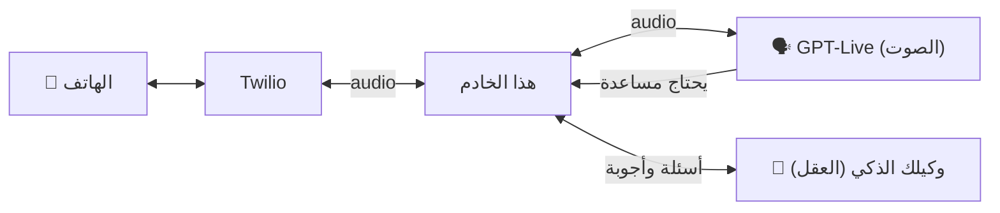

**[🇬🇧 Read in English](README.md)**

# 📞 وكيل الاتصال: امنح وكيل الذكاء الاصطناعي الخاص بك رقم هاتف

اجعل وكيل الذكاء الاصطناعي الخاص بك (Claude Code أو Codex أو أي وكيل يستطيع تشغيل الأوامر) **يُجري مكالمات هاتفية حقيقية ويستقبلها**:

- 🗣️ **الصوت:** نموذج **GPT-Live** من OpenAI (`gpt-live-1`)، وهو نموذج صوتي ثنائي الاتجاه بالكامل (يستمع ويتكلم في الوقت نفسه)، صوته طبيعي، ويتعامل مع المقاطعة، ويتحدث العربية والإنجليزية.
- 🧠 **العقل:** **وكيلك أنت**. هو من يقرر بمن يتصل ولماذا، ويجيب عن الأسئلة مباشرةً أثناء المكالمة، ويوجّهها، ثم يقرأ نص المكالمة بعد انتهائها.
- ☎️ **الخط:** رقم هاتف من **Twilio** مع خدمة Media Streams (بثّ الصوت).
- 🔐 **آمن افتراضياً:** قوائم سماح للمتصلين وللأرقام التي يُتصل بها، وإفصاح إلزامي بأن المتحدث ذكاء اصطناعي، والتحقق من طلبات الـ webhook، ورموز بثّ تُستخدم مرة واحدة، وحدود للتكلفة، والأسرار لا تُرفع إلى المستودع أبداً.

> صُمّم هذا المشروع لعرض مباشر على قناة **ذكاء (Thaka2.ai)** على يوتيوب: الذكاء الاصطناعي مشروحاً للعالم العربي.
> 👉 **[اشترك في قناة ذكاء على يوتيوب](https://www.youtube.com/@Thakaa-AI)** · 🌐 **[thaka2.ai](https://www.thaka2.ai)**

---

## 🤖 هل تستخدم وكيل ذكاء اصطناعي لإعداد المشروع؟

وجّهه إلى هذا المستودع وقل له *«جهّز هذا المشروع لي»*. سيقرأ ملف **[AGENTS.ar.md](AGENTS.ar.md)**، ويسألك هل تفضّل **العربية أم الإنجليزية**، ثم يرافقك في كل خطوة.

---

## كيف يعمل (في 30 ثانية)



نموذج الصوت هو من يدير المحادثة. وحين يحتاج إلى معلومة أو قرار أو أي شيء لا ينبغي له أن يخمّنه، فإنه **يُحيل السؤال** إلى العقل، ويقول للمتصل «دعني أتحقق»، ثم ينطق الجواب فور وصوله. التفاصيل في: [كيف يعمل](docs/ar/06-how-it-works.md).

## ما الذي تحتاجه

| | التكلفة | الدليل |
|---|---|---|
| حساب OpenAI + مفتاح API | نحو 0.05 دولار لكل دقيقة مكالمة (رصيد مدفوع مسبقاً، من 5 إلى 10 دولارات للبداية) | [الخطوة 1](docs/ar/01-openai.md) |
| حساب Twilio + رقم هاتف + مفتاح API | نحو 1.15 دولار شهرياً للرقم + سنتات لكل دقيقة | [الخطوة 2](docs/ar/02-twilio.md) |
| Node.js 20 أو أحدث، وGit، وحساب ngrok مجاني | مجاناً | [الخطوة 3](docs/ar/03-ngrok.md) |

## البدء السريع

```bash
git clone https://github.com/samerGMTM22/calling-agent-yt-demo.git
cd calling-agent-yt-demo
npm install
cp .env.example .env        # then fill in your keys: see Steps 1 and 2
npm run doctor              # checks everything, tells you what to fix
npm run up                  # starts ngrok + the server
```

(بعد نسخ `.env.example` إلى `.env` املأ مفاتيحك كما في الخطوتين 1 و2. الأمر `npm run doctor` يفحص كل شيء ويخبرك بما يجب إصلاحه، والأمر `npm run up` يشغّل ngrok والخادم.)

في نافذة طرفية (Terminal) ثانية:

```bash
npm run call -- --purpose "Say hi and check the phone agent works"   # the agent calls YOU
npm run twilio:connect -- --apply                                    # lets YOU call the agent
npm run watch                                                        # watch the call live, as the brain
```

(الأمر الأول يجعل الوكيل يتصل **بك**، والثاني يتيح لك **أنت** الاتصال بالوكيل، والثالث يتيح لك متابعة المكالمة مباشرةً بصفتك العقل.)

الشرح الكامل: **[الخطوة 4: شغّله واتصل](docs/ar/04-run-and-call.md)**

## الأدلة خطوة بخطوة

1. [OpenAI: الحساب، والفوترة، ومفتاح API](docs/ar/01-openai.md)
2. [Twilio: الحساب، والرقم، ومفتاح API، وأذونات الدول](docs/ar/02-twilio.md)
3. [Node.js وGit وngrok](docs/ar/03-ngrok.md)
4. [شغّله، اتصل به، وكن أنت العقل](docs/ar/04-run-and-call.md)
5. [**الأمان والامتثال**](docs/ar/05-security-and-compliance.md) ⚠️ اقرأه قبل أن تشارك رقمك مع أي أحد
6. [كيف يعمل](docs/ar/06-how-it-works.md)
7. [حلّ المشكلات](docs/ar/07-troubleshooting.md)

## 🔐 الأمان في لمحة

- **رقمك وحده يستطيع الاتصال بالوكيل** (`ALLOWED_CALLERS`). أي رقم آخر يُرفض قبل الرد على المكالمة. أضف [بوابة على مستوى Twilio](examples/twilio-gate-function.js) كي تبقى الحماية قائمة حتى لو كان خادمك مطفأً.
- **لا يستطيع الوكيل الاتصال إلا بالأرقام التي وافقت عليها** (`ALLOWED_DESTINATIONS`).
- **يعرّف بنفسه دائماً على أنه وكيل ذكاء اصطناعي يعمل نيابةً عنك**، ولا يدّعي أبداً أنه إنسان. حافظ على ذلك؛ ففي دول كثيرة، ومنها الولايات المتحدة بموجب قواعد هيئة FCC، تتطلب المكالمات الصوتية بالذكاء الاصطناعي إفصاحاً وموافقة.
- **الأسرار موجودة في ملف `.env` فقط**، وهذا الملف يتجاهله git. أما `.env.example` فهو القالب.
- **حدود التكلفة:** حدّ أقصى لمدة المكالمة، وحدّ أقصى لعدد المكالمات المتزامنة.

المزيد في: [الأمان والامتثال](docs/ar/05-security-and-compliance.md).

## الأوامر

| الأمر | ماذا يفعل |
|---|---|
| `npm run doctor` | يفحص الإعداد خطوة بخطوة |
| `npm run up` | يشغّل ngrok + الخادم |
| `npm run call -- --to +1… --purpose "…" [--context "…"] [--language ar]` | يُجري مكالمة |
| `npm run watch` | بثّ مباشر للأحداث (نصوص المكالمة، أسئلة العقل) |
| `npm run answer -- <questionId> "…" [--hangup]` | يجيب عن سؤال أُحيل إليك |
| `npm run say -- <callId> "…"` / `npm run note -- <callId> "…"` | يوجّه مكالمة جارية |
| `npm run hangup -- <callId>` | ينهي مكالمة |
| `npm run calls` / `npm run transcript -- <callId>` | سجل المكالمات ونصوصها |
| `npm run twilio:connect [-- --apply / --restore]` | يوجّه رقمك إلى الخادم (مع نسخة احتياطية) |
| `npm run status` | المحرّك، والعقل، والروابط، وقوائم السماح |

## انسخه واجعله خاصاً بك

هذا المشروع قالب جاهز. انسخه (Fork)، وأضف مفاتيحك الخاصة إلى `.env` (وليس إلى الكود أبداً)، وغيّر `AGENT_NAME` و`OWNER_NAME` والشخصية في `src/persona.js`، ثم اطلب من وكيلك أن يتصل بك.

## الترخيص

MIT. استخدمه، وعدّله، وشاركه. ونرجو أن تُبقي على الإفصاح بأن المتحدث ذكاء اصطناعي.

---

### ⭐ إن أفادك هذا المشروع

- 🎥 اشترك في **[قناة ذكاء (Thaka2.ai) على يوتيوب](https://www.youtube.com/@Thakaa-AI)** لمزيد من مشاريع وكلاء الذكاء الاصطناعي، بالعربية
- 🌐 زُر موقعنا **[thaka2.ai](https://www.thaka2.ai)**
- ⭐ ضع نجمة لهذا المستودع ليصل إلى غيرك
