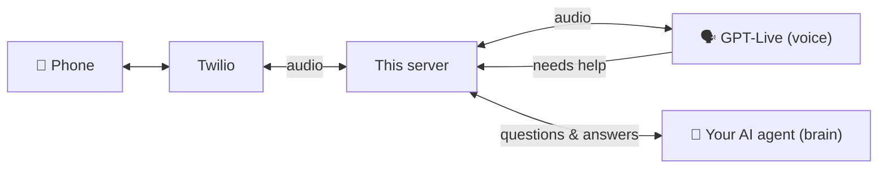

# 📞 Calling Agent: give your AI agent a phone

**[🇸🇦 اقرأ بالعربية](README.ar.md)**

Let your AI agent (Claude Code, Codex, or any agent that can run commands) **make and receive real phone calls**:

- 🗣️ **Voice:** OpenAI **GPT-Live** (`gpt-live-1`), a full-duplex voice model that sounds natural, handles interruptions, and speaks Arabic and English.
- 🧠 **Brain:** **your agent**. It decides who to call and why, answers questions live during the call, steers it, and reads the transcript afterwards.
- ☎️ **Line:** **Twilio** phone number + Media Streams.
- 🔐 **Safe by default:** caller and destination allowlists, mandatory AI disclosure, verified webhooks, one-time stream tokens, cost caps, secrets never committed.

> Built for a live demo on the **Thaka2.ai (ذكاء)** YouTube channel: AI explained for the Arabic-speaking world.
> 👉 **[Subscribe on YouTube](https://www.youtube.com/@Thakaa-AI)** · 🌐 **[thaka2.ai](https://www.thaka2.ai)**

---

## 🤖 Using an AI agent to set this up?

Point it at this repository and say *"set this up for me"*. It will read **[AGENTS.md](AGENTS.md)**, ask whether you prefer **Arabic or English**, and walk you through every step.

---

## How it works (30 seconds)



The voice model runs the conversation. When it needs facts, a decision or anything it shouldn't guess, it **delegates** to the brain, says "let me check", and speaks the answer when it arrives. Details: [How it works](docs/en/06-how-it-works.md).

## What you need

| | Cost | Guide |
|---|---|---|
| OpenAI account + API key | ≈ $0.05 per call minute (prepaid credits, $5–10 to start) | [Step 1](docs/en/01-openai.md) |
| Twilio account + phone number + API key | ≈ $1.15/month number + cents per minute | [Step 2](docs/en/02-twilio.md) |
| Node.js 20+, Git, free ngrok account | free | [Step 3](docs/en/03-ngrok.md) |

## Quick start

```bash
git clone https://github.com/samerGMTM22/calling-agent-yt-demo.git
cd calling-agent-yt-demo
npm install
cp .env.example .env        # then fill in your keys: see Steps 1 and 2
npm run doctor              # checks everything, tells you what to fix
npm run up                  # starts ngrok + the server
```

In a second terminal:

```bash
npm run call -- --purpose "Say hi and check the phone agent works"   # the agent calls YOU
npm run twilio:connect -- --apply                                    # lets YOU call the agent
npm run watch                                                        # watch the call live, as the brain
```

Full walkthrough: **[Step 4: Run it and call](docs/en/04-run-and-call.md)**

## Step-by-step guides

1. [OpenAI: account, billing, API key](docs/en/01-openai.md)
2. [Twilio: account, number, API key, geo permissions](docs/en/02-twilio.md)
3. [Node.js, Git and ngrok](docs/en/03-ngrok.md)
4. [Run it, call it, be the brain](docs/en/04-run-and-call.md)
5. [**Security and compliance**](docs/en/05-security-and-compliance.md) ⚠️ read before sharing your number
6. [How it works](docs/en/06-how-it-works.md)
7. [Troubleshooting](docs/en/07-troubleshooting.md)

## 🔐 Security at a glance

- **Only your number can call the agent** (`ALLOWED_CALLERS`). Others are rejected before the call is answered. Add a [Twilio-level gate](examples/twilio-gate-function.js) so it holds even when your server is off.
- **The agent can only call numbers you approved** (`ALLOWED_DESTINATIONS`).
- **It always introduces itself as your AI agent** and never claims to be human. Keep it that way; in many countries, including under US FCC rules, AI voice calls need disclosure and consent.
- **Secrets live only in `.env`**, which is git-ignored. `.env.example` is the template.
- **Cost caps:** max call length and max concurrent calls.

More: [Security and compliance](docs/en/05-security-and-compliance.md).

## Commands

| Command | What it does |
|---|---|
| `npm run doctor` | Check setup step by step |
| `npm run up` | Start ngrok + server |
| `npm run call -- --to +1… --purpose "…" [--context "…"] [--language ar]` | Place a call |
| `npm run watch` | Live event feed (transcripts, brain questions) |
| `npm run answer -- <questionId> "…" [--hangup]` | Answer a delegated question |
| `npm run say -- <callId> "…"` / `npm run note -- <callId> "…"` | Steer a live call |
| `npm run hangup -- <callId>` | End a call |
| `npm run calls` / `npm run transcript -- <callId>` | History and transcripts |
| `npm run twilio:connect [-- --apply / --restore]` | Point your number at the server (with backup) |
| `npm run status` | Engine, brain, URLs, allowlists |

## Fork it and make it yours

This is a template. Fork it, add your own keys to `.env` (never to the code), change `AGENT_NAME`, `OWNER_NAME` and the persona in `src/persona.js`, and ask your agent to call you.

## License

MIT. Use it, change it, share it. Please keep the AI disclosure.

---

### ⭐ If this helped you

- 🎥 Subscribe to **[Thaka2.ai on YouTube](https://www.youtube.com/@Thakaa-AI)** for more AI agent builds, in Arabic
- 🌐 Visit **[thaka2.ai](https://www.thaka2.ai)**
- ⭐ Star this repo so others can find it
