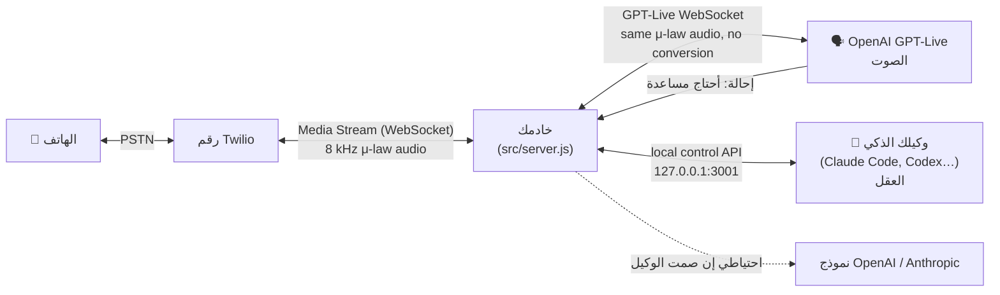

# كيف يعمل

## الفصل بين الصوت والعقل

- **الصوت: GPT-Live من OpenAI (`gpt-live-1`).** نموذج كلام ثنائي الاتجاه بالكامل: يستمع ويتكلم في الوقت نفسه، ويتعامل بطبيعية مع المقاطعة ومع عبارات التفاعل القصيرة (مثل «إمم» و«أها»)، ويكلّف نحو 0.05 دولار للدقيقة. هو من يدير المحادثة.
- **العقل: وكيلك الذكي.** يقرر *بمن* يتصل و*لماذا* (فالخياران `--purpose` و`--context` يصبحان تعليمات الصوت)، ويجيب عن الأسئلة المُحالة إليه مباشرةً، ويستطيع توجيه المكالمة (`say`، `note`)، وإنهاءها، وقراءة نصها بعد انتهائها.

يدعم GPT-Live ما يُسمّى **الإحالة إلى العميل** (client delegation): فحين يحتاج إلى تفكير أو معلومات أو أدوات، يُصدر الحدث `session.delegation.created`. يستخلص الخادم سؤال المتصل من النص المباشر للمكالمة، ويرسله إلى العقل، ثم يعيد الجواب عبر `session.commentary.append`. بعدها يقول GPT-Live الجواب بأسلوبه الخاص. وفي أثناء ذلك يواصل التحدث مع المتصل كي لا يشعر بالانتظار («دعني أتحقق من ذلك»).

## مسار المكالمة

**المكالمة الصادرة** (`npm run call`):
1. تتحقق واجهة التحكم من `ALLOWED_DESTINATIONS`، وتُنشئ سجلاً للمكالمة ورمز بثّ يُستخدم مرة واحدة.
2. تتصل واجهة Twilio REST API بالرقم باستخدام TwiML مضمّن: `<Connect><Stream url="wss://…/media-stream">` + الرمز بصفته `<Parameter>`.
3. عند الرد، تفتح Twilio قناة WebSocket. يتحقق الخادم من الرمز ويفتح جلسة GPT-Live مع الشخصية وموجز المكالمة.
4. يطلب الخادم من GPT-Live أن يبدأ بالتحية (مع الإفصاح بأنه ذكاء اصطناعي).

**المكالمة الواردة**:
1. ترسل Twilio طلب POST إلى `/twilio/voice`. يتحقق الخادم من أن الطلب أصيل وأن المتصل موجود في `ALLOWED_CALLERS`، وإلا فإنه يعيد `<Reject>` (رفض).
2. يرد بنفس TwiML الخاص بـ `<Connect><Stream>`، ثم تتبعه الخطوتان 3 و4 أعلاه.

## مسار الصوت

تنقل Twilio Media Streams الصوت بصيغة **G.711 μ-law بتردد 8 kHz** داخل إطارات JSON مُرمّزة بـ base64. ويقبل GPT-Live هذه الصيغة نفسها تماماً (`audio/pcmu`، `8000`)، فيمرّ الصوت دون أي تعديل في الاتجاهين. وهذا يعني: لا إعادة تحويل لمعدل العيّنات، وأقل تأخير ممكن، ولا شيء يمكن أن يتعطل. يبثّ GPT-Live مخرجاته بسرعة الزمن الحقيقي (بما في ذلك فترات الصمت)، فيتولى النموذج التعامل مع المقاطعات، ويبقى المخزن المؤقت (buffer) لدى Twilio صغيراً.

أما المحرّك البديل (`VOICE_ENGINE=realtime`، `gpt-realtime-2.1`) فيعمل بنظام تبادل الأدوار. وفيه يطبّق الخادم بنفسه خاصية المقاطعة (barge-in) بالطريقة نفسها التي يتبعها المثال المرجعي من Twilio: عند الحدث `input_audio_buffer.speech_started` يقصّ صوت المساعد عند الموضع الذي تم تشغيله، ويرسل إلى Twilio الأمر `clear`. ويتم الوصول إلى العقل عبر أداة دالة اسمها `ask_brain`.

## الملفات

| الملف | الدور |
|---|---|
| `src/server.js` | روابط webhook العامة + WebSocket للصوت، وواجهة التحكم المحلية |
| `src/engines/live.js` | جسر GPT-Live + الإحالة |
| `src/engines/realtime.js` | جسر gpt-realtime + أدوات الدوال + المقاطعة (barge-in) |
| `src/brain.js` | أنواع العقل agent / openai / anthropic / none، مع المهلة الزمنية + العقل الاحتياطي |
| `src/persona.js` | التعليمات، والإفصاح بأن المتحدث ذكاء اصطناعي، والتحية، وقواعد الأمان |
| `src/twilio.js` | Twilio REST، وTwiML، والتحقق من طلبات الـ webhook |
| `src/calls.js` | سجل المكالمات، وبثّ الأحداث، ونصوص المكالمات |
| `scripts/agent.js` | واجهة أوامر (CLI) للوكلاء: call، watch، answer، say، note، hangup… |
| `scripts/doctor.js` | أداة فحص الإعداد |
| `scripts/twilio-connect.js` | توجّه رقمك إلى الخادم (مع نسخ احتياطي واستعادة) |
| `scripts/up.js` | تشغّل ngrok + الخادم |

## المراجع الرسمية

- OpenAI GPT-Live: https://developers.openai.com/api/docs/guides/realtime-websocket (قسم GPT-Live)، والإحالة (delegation): https://developers.openai.com/api/docs/guides/live-delegation، والجلسات (sessions): https://developers.openai.com/api/docs/guides/live-conversations
- OpenAI Realtime: https://developers.openai.com/api/docs/guides/realtime-conversations
- رسائل Twilio Media Streams: https://www.twilio.com/docs/voice/media-streams/websocket-messages
- المثال المرجعي من Twilio: https://github.com/twilio-samples/speech-assistant-openai-realtime-api-node

---
🎥 شروحات معمّقة مثل هذه، بالعربية: [اشترك في قناة ذكاء (Thaka2.ai) على يوتيوب](https://www.youtube.com/@Thakaa-AI) · [thaka2.ai](https://www.thaka2.ai)
