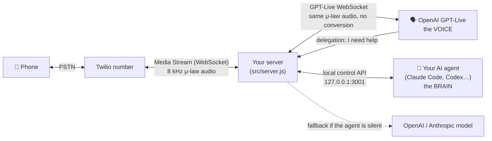

# How it works

## The voice / brain split

- **Voice: OpenAI GPT-Live (`gpt-live-1`).** A full-duplex speech model: it listens and speaks at the same time, handles interruptions and back-channels ("mm-hm") naturally, and costs about $0.05/min. It runs the conversation.
- **Brain: your AI agent.** It decides *who* to call and *why* (`--purpose`, `--context` become the voice's instructions), answers delegated questions live, can steer the call (`say`, `note`), hangs up, and reads the transcript afterwards.

GPT-Live supports **client delegation**: when it needs reasoning, facts or tools, it emits `session.delegation.created`. The server works out the caller's question from the live transcript, sends it to the brain, and returns the answer with `session.commentary.append`. GPT-Live then says it in its own words. Meanwhile it keeps the caller company ("let me check that").

## Call flow

**Outbound** (`npm run call`):
1. The control API checks `ALLOWED_DESTINATIONS`, creates a call record and a one-time stream token.
2. Twilio's REST API dials the number with inline TwiML: `<Connect><Stream url="wss://…/media-stream">` + the token as a `<Parameter>`.
3. When answered, Twilio opens the WebSocket. The server validates the token and opens a GPT-Live session with the persona and call brief.
4. The server asks GPT-Live to greet first (with the AI disclosure).

**Inbound**:
1. Twilio POSTs to `/twilio/voice`. The server verifies the request is genuine and the caller is in `ALLOWED_CALLERS`, otherwise it returns `<Reject>`.
2. If `INBOUND_PIN` is set, it answers with `<Gather>`: the caller types the PIN on the keypad (3 tries, then goodbye). Twilio posts the digits to `/twilio/pin`, which runs the same checks again.
3. It answers with the same `<Connect><Stream>` TwiML, and steps 3–4 above follow.

**Ending a call:** the voice model cannot hang up by itself. When the caller says goodbye, it delegates; the brain answers with `--hangup` (or the fallback brain adds a hang-up marker), the goodbye is spoken, and the server ends the call. `MAX_CALL_SECONDS` is the hard stop.

## Audio path

Twilio Media Streams carry **G.711 μ-law at 8 kHz** in base64 JSON frames. GPT-Live accepts exactly that format (`audio/pcmu`, `8000`), so audio passes through untouched in both directions. That means no resampling, the lowest latency, and nothing to go wrong. GPT-Live streams its output at real-time pace (silence included), so interruptions are handled by the model and Twilio's buffer stays small.

The alternative engine (`VOICE_ENGINE=realtime`, `gpt-realtime-2.1`) is turn-based. There the server implements barge-in itself the way Twilio's reference sample does: on `input_audio_buffer.speech_started` it truncates the assistant's audio at the played position and sends Twilio a `clear`. The brain is reached through an `ask_brain` function tool.

## Files

| File | Role |
|---|---|
| `src/server.js` | Public webhooks, PIN gate, media WebSocket, local control API (token-protected) |
| `src/engines/live.js` | GPT-Live bridge + delegation |
| `src/engines/realtime.js` | gpt-realtime bridge + function tools + barge-in |
| `src/brain.js` | agent / openai / anthropic / none brains, timeout + fallback |
| `src/persona.js` | Instructions, `persona.md` loading, AI disclosure, greeting, safety rules |
| `src/twilio.js` | Twilio REST, TwiML, webhook verification |
| `src/calls.js` | Call registry, event feed, transcripts |
| `scripts/agent.js` | CLI for agents: call, watch, answer, say, note, hangup… |
| `scripts/doctor.js` | Setup checker |
| `scripts/twilio-connect.js` | Points your number at the server (with backup/restore) |
| `scripts/up.js` | Starts ngrok + server |

## Official references

- OpenAI GPT-Live: https://developers.openai.com/api/docs/guides/realtime-websocket (GPT-Live section), delegation: https://developers.openai.com/api/docs/guides/live-delegation, sessions: https://developers.openai.com/api/docs/guides/live-conversations
- OpenAI Realtime: https://developers.openai.com/api/docs/guides/realtime-conversations
- Twilio Media Streams messages: https://www.twilio.com/docs/voice/media-streams/websocket-messages
- Twilio's reference sample: https://github.com/twilio-samples/speech-assistant-openai-realtime-api-node

---
🎥 Deep dives like this, in Arabic: [Thaka2.ai on YouTube](https://www.youtube.com/@Thakaa-AI) · [thaka2.ai](https://www.thaka2.ai)
